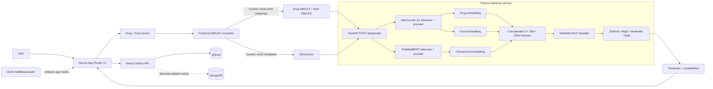

<div align="center">

# 🛡️ MedSafe AI — Drug–Food Interaction Prototype

**A full-stack research prototype for exploring potential drug–food interactions with molecular and biomedical-text features.**

[](https://nextjs.org/)
[](https://www.typescriptlang.org/)
[](https://tailwindcss.com/)
[](https://www.python.org/)
[](https://pytorch.org/)
[](https://huggingface.co/docs/transformers)
[](https://www.sqlite.org/)

[Quick Start](#-quick-start) · [Architecture](#-system-architecture) · [Model](#-model-and-algorithm) · [API](#-inference-api) · [Setup Guide](SETUP_GUIDE.md) · [Limitations](#-important-limitations)

</div>

---

> [!WARNING]
> **Not for medical use.** MedSafe is an experimental software prototype, not a medical device or validated clinical decision-support system. Its predictions may be inaccurate or based on placeholder input data. Do not use it to make medication, diet, diagnosis, or treatment decisions. Consult a qualified healthcare professional.

## 📌 Overview

MedSafe combines a **Next.js and TypeScript web application** with a **FastAPI and PyTorch inference service**. The intended workflow takes a drug and food, represents their molecular structures as SMILES, combines those inputs with biomedical text, and predicts one of three classes: **Major**, **Moderate**, or **Safe**.

The repository includes a pretrained-feature inference pipeline and model checkpoint. However, the current frontend uses **hard-coded mock SMILES mappings and randomly selected mock clinical text**. It does not currently perform live PubMed, FooDB, or PubChem lookups. Treat the application as a prototype demonstration, not a source of verified interaction information.

## ✨ Features

| Area | Current implementation |
|---|---|
| Interaction form | Drug and food name input in the dashboard |
| Molecular inputs | Local mock name-to-SMILES mappings; unknown names fall back to a generic benzene SMILES |
| Clinical text | Mock text selected from preset templates |
| Prediction | FastAPI endpoint backed by frozen Transformer encoders and a trained PyTorch MLP |
| Results | Severity label, model confidence, and class probability chart |
| Authentication | Clerk dependency and middleware are configured in the frontend |
| History | Clerk-protected Next.js history routes backed by SQLite |
| Alternate storage | MongoDB adapter exists, but the current history routes use SQLite directly |
| Theme | Light/dark mode with local browser preference |

## 🏗️ System Architecture



<details open>
<summary><b>🔬 Inference flow, step by step</b></summary>

1. The dashboard accepts a drug name and a food name.
2. The frontend converts both names using local mock dictionaries and constructs mock clinical text.
3. The client sends `drug_smiles`, `food_smiles`, and `clinical_text` to `POST /api/predict`.
4. MoLFormer-XL encodes the drug and food SMILES separately.
5. PubMedBERT encodes the clinical text.
6. The three 768-dimensional pooled outputs are concatenated into a 2,304-dimensional vector.
7. A trained MLP produces three logits. Softmax probabilities are mapped to `Major`, `Moderate`, and `Safe`.
8. The frontend displays the predicted class, confidence, and probability breakdown.

</details>

## 🧠 Model and Algorithm

The inference implementation in `medsafe-backend/main.py` defines `MedSafeMLP` and loads its weights from `medsafe_optimized_model.pth`.

### Feature encoders

| Input | Encoder | Representation |
|---|---|---:|
| Drug SMILES | `ibm/MoLFormer-XL-both-10pct` | 768-dimensional pooled output |
| Food SMILES | `ibm/MoLFormer-XL-both-10pct` | 768-dimensional pooled output |
| Clinical text | `microsoft/BiomedNLP-PubMedBERT-base-uncased-abstract-fulltext` | 768-dimensional pooled output |
| Concatenated features | `torch.cat([drug, food, text])` | 2,304 dimensions |

The backend tokenizes SMILES with a maximum length of 128 and clinical text with a maximum length of 256. It uses each encoder's `pooler_output`.

### Classifier

```text
2,304 input features
       │
Linear(2304 → 1024) → BatchNorm → LeakyReLU(0.1) → Dropout(0.4)
       │
Linear(1024 → 256) → BatchNorm → LeakyReLU(0.1) → Dropout(0.3)
       │
Linear(256 → 3)
       │
Softmax → Major / Moderate / Safe
```

The inference class mapping is:

| Class index | Label |
|---:|---|
| 0 | Major |
| 1 | Moderate |
| 2 | Safe |

No verified benchmark report or model-card metrics are included in this repository. Do not infer model accuracy, clinical validity, or safety from the checkpoint being present.

## 🚀 Quick Start

See the cross-platform [Setup Guide](SETUP_GUIDE.md) for complete instructions.

### Start the backend

```bash
cd medsafe-backend
python -m venv .venv

# Linux / macOS
source .venv/bin/activate

# Windows PowerShell
# .\.venv\Scripts\Activate.ps1

python -m pip install --upgrade pip
python -m pip install -r requirements.txt
python -m uvicorn main:app --host 127.0.0.1 --port 8001
```

The first startup downloads the pretrained Transformer encoders from Hugging Face. Start the command from `medsafe-backend`; the checkpoint is loaded using a path relative to the backend working directory.

### Start the frontend

In another terminal:

```bash
cd medsafe-frontend
npm install
cp .env.example .env.local
npm run dev
```

Open [http://localhost:3000](http://localhost:3000). Set Clerk credentials in `.env.local` for authentication. The frontend defaults to the backend at `http://127.0.0.1:8001`.

## 🧪 Inference API

FastAPI provides interactive OpenAPI documentation at:

- Swagger UI: `http://127.0.0.1:8001/docs`
- ReDoc: `http://127.0.0.1:8001/redoc`
- OpenAPI JSON: `http://127.0.0.1:8001/openapi.json`

### `POST /api/predict`

Request:

```json
{
  "drug_smiles": "CC(=O)NC1=CC=C(O)C=C1",
  "food_smiles": "C1=CC(=C(C=C1)O)O",
  "clinical_text": "Example clinical context supplied to the model"
}
```

Response shape:

```json
{
  "status": "success",
  "source": "ml",
  "prediction": {
    "severity_score": 2,
    "severity_label": "Safe",
    "confidence": "71.56%",
    "raw_probabilities": {
      "Major": 0.1702,
      "Moderate": 0.1142,
      "Safe": 0.7156
    }
  }
}
```

The values above illustrate the response format only; they are not a validated result for the example inputs.

## 🗂️ Repository Structure

```text
Medsafe_interaction_checker/
├── README.md
├── SETUP_GUIDE.md
├── LICENSE
├── medsafe-backend/
│   ├── main.py                         # FastAPI API, encoders, MLP inference
│   ├── README.md                       # Backend and Swagger/API guide
│   ├── requirements.txt
│   └── medsafe_optimized_model.pth     # Trained classifier weights
└── medsafe-frontend/
    ├── app/                            # Next.js routes and API handlers
    ├── components/                     # Interaction form, results, theme, UI
    ├── lib/
    │   ├── api-client.ts               # Backend HTTP client
    │   ├── smiles-converter.ts         # Current mock converters/text
    │   ├── db-sqlite.ts                # SQLite history adapter
    │   ├── db-mongodb.ts               # MongoDB adapter (not wired to routes)
    │   └── store.ts                    # Zustand UI state
    ├── types/
    ├── .env.example
    └── package.json
```

## 🔐 Configuration and Data

Frontend environment template: `medsafe-frontend/.env.example`.

| Variable | Use in current code |
|---|---|
| `NEXT_PUBLIC_CLERK_PUBLISHABLE_KEY` | Clerk frontend configuration |
| `CLERK_SECRET_KEY` | Clerk server configuration |
| `NEXT_PUBLIC_API_URL` | Backend base URL; defaults to `http://127.0.0.1:8001` |
| `MONGODB_URI` | Used by the MongoDB adapter, which is not currently connected to history routes |
| `DATABASE_URL` | Present in the template; SQLite adapter currently constructs its own local path |
| `PUBMED_API_KEY` | Present in the template; current SMILES/clinical-text converter does not use it |

The active history endpoints import SQLite operations directly. The database is located under the frontend working directory at `data/medsafe.db`; ensure that directory exists before making history requests.

## ⚠️ Important Limitations

- **Prototype only:** Predictions are not validated for clinical use and must not guide patient care.
- **Placeholder frontend data:** Drug/food name conversion is backed by hard-coded mock maps. Unknown names use a generic fallback SMILES.
- **Mock clinical context:** The frontend selects a preset clinical-text template at random; it does not currently query PubMed.
- **No reported evaluation:** This repository does not include verified metrics, external validation, or a clinical model card.
- **Database configuration gap:** SQLite is wired to the history routes; the MongoDB adapter is present but is not selected by those routes.
- **Security before deployment:** The backend currently allows all CORS origins. Restrict CORS, add authentication/authorization for inference, validate inputs, and review data protection before exposing it beyond local development.
- **Third-party model downloads:** Backend startup requires internet access to download the configured Hugging Face encoders unless they are already cached.

## 📚 Documentation

- [Setup Guide](SETUP_GUIDE.md) — prerequisites, environment setup, startup, and troubleshooting
- [Backend README](medsafe-backend/README.md) — model loading and inference API details
- [FastAPI Swagger UI](http://127.0.0.1:8001/docs) — available when the backend is running
- [MedSafe frontend](medsafe-frontend/) — Next.js application source

## 📄 License

This repository includes an [Apache License 2.0](LICENSE). The model checkpoint and third-party pretrained models may have separate terms; verify their provenance and licenses independently.
